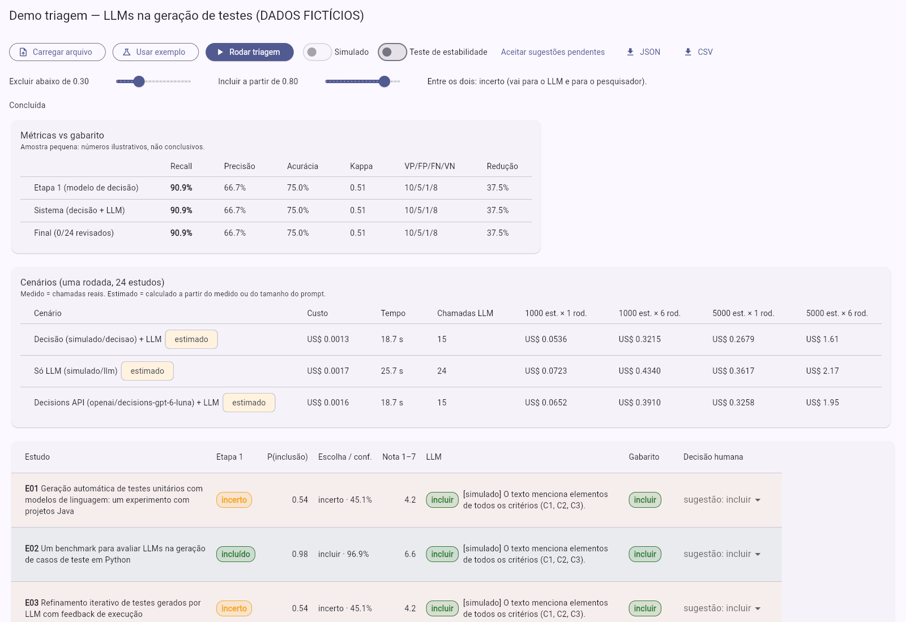

# Triagem com modelo de decisão (Jev) + LLM — protótipo

Protótipo para a reunião de orientação do mestrado: um **modelo de decisão** (Jev, da TypeSafe AI) faz a triagem pesada de título e resumo, um **LLM** só entra nos estudos incluídos ou incertos para justificar a decisão, e o **pesquisador decide no final**. O plano completo está em [`docs/plano.md`](docs/plano.md).

> É uma hipótese a medir, não um resultado. A amostra de exemplo é pequena e **fictícia**.



## Estado

| Item do plano (seção 11) | Situação |
|---|---|
| 1. Modelos de domínio e leitura do arquivo | ✅ |
| 2. Cliente Jev + orquestrador da etapa 1 | ✅ formato conferido na documentação (29/10/2026) · falta a 1ª rodada real |
| 3. Métricas vs gabarito (recall, precisão, acurácia, Kappa, redução) | ✅ |
| 4. Cliente LLM + etapa 2 | ✅ (OpenRouter, qualquer modelo) |
| 5. Custo e comparação dos 3 cenários + projeção 1.000/5.000 × 6 rodadas | ✅ (medido × estimado na tela) |
| 6. Tela com tabela colorida e resumo | ✅ |
| 7. Edição da decisão humana | ✅ |
| 8. OpenAI Decisions | ✅ estimado pelos tokens (cliente real reaproveitável: `ClienteDecisaoOpenRouter(rota: …)`) |
| 9. Teste de estabilidade (ordem das opções invertida) | ✅ interruptor na tela |
| Por critério, como os templates do grupo (Booleano I/E + Likert 1–7, e a soma) | ✅ mesma chamada ao Jev; coluna na tabela e no CSV |
| Exportar JSON (com config, preços e log de cada chamada) e CSV | ✅ |

## Arquitetura

O mesmo padrão do PacDart: **Flutter com pastas por funcionalidade (domain / data / presentation) e Cubit**, mais um **Worker da Cloudflare** que guarda a chave (o app nunca vê a chave).

```
triagem_jev/
├── app/                                  Flutter (web)
│   ├── assets/exemplo_triagem.json       24 estudos fictícios + gabarito + 3 critérios
│   ├── assets/precos.json                tabela de preços configurável (US$/1M tokens)
│   └── lib/features/triagem/
│       ├── domain/   Dart puro, testável — não conhece HTTP nem Flutter
│       │   ├── estudo.dart               Estudo, Criterio, ProjetoTriagem, Decisao
│       │   ├── decisoes.dart             DecisaoModelo, JustificativaLlm, DecisaoHumana, Uso, RegistroChamada
│       │   ├── portas.dart               IDecisionModelClient, ILlmClient  ← troca de modelo acontece aqui
│       │   ├── resultado_estudo.dart     Faixa (regra 0,80 / 0,30) e a linha da tabela
│       │   ├── orquestrador_triagem.dart etapa 1 → encaminhamento → etapa 2, grava cada chamada
│       │   ├── metricas.dart             matriz de confusão, recall, precisão, Kappa…
│       │   ├── custo.dart                calculadora de custo, 3 cenários e projeção
│       │   └── prompt_llm.dart           prompt da etapa 2 (boas práticas do grupo)
│       ├── data/
│       │   ├── cliente_decisao.dart      Jev / Decisions API via Worker
│       │   ├── cliente_llm.dart          LLM via Worker (chat/completions do OpenRouter)
│       │   ├── clientes_simulados.dart   heurística local, sem internet e sem custo
│       │   └── arquivos_triagem.dart     leitura do JSON, exportação JSON/CSV
│       └── presentation/                 TriagemCubit + página única
└── worker/                               Cloudflare Worker (TypeScript): /jev e /llm → TypeSafe, Anthropic, OpenAI ou OpenRouter
```

O app usa sempre os ids do OpenRouter (`typesafe/jev-1.14`, `anthropic/claude-haiku-5.5`…). O Worker escolhe o caminho em cada pedido: a **chave da própria empresa**, se existir no `.dev.vars` (TypeSafe, Anthropic, OpenAI), ou então uma chave do **OpenRouter**, que sozinha serve para tudo. Os ids de cada empresa ficam em `worker/src/config.ts` (`IDS_DIRETOS`). Pela Anthropic, o Worker usa o SDK oficial (`@anthropic-ai/sdk`) e devolve a resposta no mesmo formato chat/completions, para o app não mudar.

## Rodar

Pré-requisitos: Flutter 3.41+ e Node 22.

### Modo simulado (sem chave, sem internet)

```sh
cd triagem_jev/app
flutter run -d chrome
```

Clique em **Usar exemplo** → **Rodar triagem**. A "decisão" simulada é uma heurística de palavras em comum com os critérios: serve para ensaiar a tela, **não é o Jev**. Os números aparecem como *estimado*.

### Modo real (Jev + LLM pelo OpenRouter)

1. Coloque as chaves em `triagem_jev/worker/.dev.vars` (esse arquivo não vai para o git). Use as das empresas, a do OpenRouter, ou as duas (a da empresa tem prioridade):
   ```
   TYPESAFE_API_KEY=...        # Jev direto (console.typesafe.ai)
   ANTHROPIC_API_KEY=sk-ant-…  # Claude direto
   OPENAI_API_KEY=sk-…         # GPT direto
   OPENROUTER_API_KEY=sk-or-…  # opcional: serve para todos os modelos
   ```
   Defina um **limite de gasto** em cada conta. Linha vazia conta como "sem chave". Depois de mudar o `.dev.vars`, reinicie o Worker.

   **Ou pelo painel:** no modo real, o botão **Chaves de API** abre campos para as chaves da Anthropic e da OpenAI. Elas ficam só na memória da aba (somem ao recarregar), vão ao Worker no cabeçalho `x-chave-<empresa>` e têm prioridade sobre as do `.dev.vars`. Não entram no estado do Cubit, no log nem no JSON/CSV exportado (há testes para isso). Use só com o Worker local, ou com um Worker publicado em HTTPS.
3. Suba o Worker local:
   ```sh
   cd triagem_jev/worker
   npm ci
   npm run dev          # http://localhost:8787
   ```
4. Rode o app apontando para ele:
   ```sh
   cd triagem_jev/app
   flutter run -d chrome --dart-define=WORKER_URL=http://localhost:8787
   ```
   Opcional: `--dart-define=MODELO_LLM=anthropic/claude-sonnet-5.5` (o modelo precisa estar em `assets/precos.json` e em `MODELOS_PERMITIDOS` no `wrangler.toml`).
5. Ligue o interruptor **Modelos reais** e rode.

Se for publicar o Worker (`npx wrangler deploy`), defina `TOKEN_ACESSO` (`npx wrangler secret put TOKEN_ACESSO`), passe o mesmo valor ao app com `--dart-define=TOKEN_ACESSO=…` e coloque a origem do site em `ORIGENS`. Sem isso, qualquer pessoa que achar a URL gasta o seu crédito.

## O que já foi conferido (29/10/2026)

1. **Formato da Decisions API do Jev**, na [referência oficial](https://openrouter.ai/docs/api/api-reference/alphadecisions/submit-a-decisions-questions-and-answers-request.md) e numa resposta real do Jev 1.13:
   - `POST https://openrouter.ai/api/alpha/decisions` (o servidor dessa rota é `https://openrouter.ai`, sem `/api/v1`), com `Authorization: Bearer <chave do OpenRouter>`;
   - pedido `{model, state, questions}`, e `questions` é um **mapa** nome → `{type, instructions, criteria}`. Tipos: `noul` (`criteria: {true, false}`), `choice` (`criteria` = mapa opção → descrição; **não existe** `options`) e `score` (`criteria` = lista de níveis, e a posição na lista é o nível, a partir de 0);
   - resposta `{model, answers, usage: {input_tokens, output_tokens, cost}}`: noul → `noul`; choice → `choice`, `confidence`, `probabilities`; score → `score`, `confidence`, `probabilities` (`"0".."6"`) e `legend`.
   - As perguntas vão em **inglês** (o Jev é treinado em inglês e lê as instruções ao pé da letra); o estudo e os critérios vão como estão.
   - Acima de ~32 mil bytes de texto o Jev entra num modo de contexto longo, mais lento e menos preciso. Um estudo fica muito abaixo disso.
2. **Rodadas reais (29/10/2026)**: veja [Resultados das rodadas reais](#resultados-das-rodadas-reais-29102026).
3. **Ids e preços** (API pública de modelos do OpenRouter; na TypeSafe direta o Jev 1.14 é `jev-1.14.0`, pelo mesmo preço): `typesafe/jev-1.14` a US$ 0,042/M de entrada (saída grátis; 1.13 ainda disponível pelo mesmo preço); `anthropic/claude-haiku-5.5` 0,10/0,50; `anthropic/claude-sonnet-5.5` 2,00/10,00; `openai/gpt-6-luna` 0,10/0,50. O Jev fica **fixado na 1.14** para as rodadas serem reproduzíveis (`~typesafe/jev-latest` muda sozinho).
4. **OpenAI Decisions API:** não achei no OpenRouter. O cenário 3 continua **estimado** com 0,10/M de entrada.
5. **Temperatura zero:** os modelos que raciocinam antes de responder (Claude atuais, GPT-5/6) recusam `temperature` e `top_p` (erro 400; o GPT-6 Luna só aceita o padrão, 1). Para eles o cliente não envia esses parâmetros. Para os demais, envia 0. Isso fica registrado no log de cada chamada, e é uma diferença em relação ao protocolo do grupo (temperatura zero) que vale citar.
6. **O raciocínio conta no `max_tokens`**, por isso o pedido a esses modelos usa 2000. Na API direta da OpenAI o campo se chama `max_completion_tokens` (o Worker traduz). Se o Claude recusar por segurança, o estudo fica com erro e vai para o pesquisador: o Worker não troca de modelo em silêncio.

## Resultados das rodadas reais (29/10/2026)

Jev 1.14 direto pela TypeSafe na etapa 1 (3 perguntas gerais + booleano e Likert por critério = 9 perguntas por estudo), nos **24 estudos fictícios** do exemplo. Arquivos exportados (JSON com o log de cada chamada, CSV e capturas) em [`docs/rodadas/`](docs/rodadas/), para mostrar sem depender de internet.

| Rodada | Etapa 2 | Custo total | Tempo | Chamadas LLM | Erros |
|---|---|---|---|---|---|
| [Jev + Claude Haiku 5.5](docs/rodadas/2026-10-29-jev-1.14-haiku-5.5/) | 11 de 24 | US$ 0,0033 | 28,6 s | 11 | 0 |
| [Jev + GPT-6 Luna](docs/rodadas/2026-10-29-jev-1.14-gpt-6-luna/) | 11 de 24 | US$ 0,0025 | 32,0 s | 11 | 0 |
| [Jev + Claude Sonnet 5.5](docs/rodadas/2026-10-29-jev-1.14-sonnet-5.5/) | 11 de 24 | US$ 0,0275 | 27,9 s | 11 | 0 |

"Só LLM" (o jeito atual do grupo), **estimado** a partir das chamadas medidas: Haiku US$ 0,0037 · Luna US$ 0,0020 · **Sonnet US$ 0,0564**.

Por estudo (médias medidas):

| | Tokens | Custo | Tempo | × Jev no custo |
|---|---|---|---|---|
| Jev (9 perguntas) | 1.622 de entrada | US$ 0,000068 | 0,25 s | 1× |
| GPT-6 Luna | 276 + 110 | US$ 0,000082 | 2,4 s | 1,2× |
| Claude Haiku 5.5 | 475 + 213 | US$ 0,000154 | 2,0 s | 2,3× |
| Claude Sonnet 5.5 | 475 + 140 | US$ 0,002348 | 2,0 s | 35× |

**Leitura honesta:**
- **Acerto:** 100% de recall e precisão nas três rodadas, 54% dos estudos sem precisar do LLM. A amostra é fictícia e fácil: isso mostra que o caminho funciona, não que o Jev acerta. Ficaram incertos só E08 (literatura cinzenta) e E24; no E08 o LLM respondeu "não encontrei informação suficiente para C3" em vez de inventar.
- **Tempo:** o Jev é ~9× mais rápido por estudo (0,25 s × 2 a 2,4 s).
- **Custo: a vantagem depende do preço do LLM.** Com LLMs baratos (Haiku 5.5, GPT-6 Luna, US$ 0,10/M) o Jev custa quase o mesmo por estudo, e com o Luna o cenário "só LLM" saiu **mais barato** (US$ 0,0020 estimado × 0,0025). Com um LLM do nível que o grupo usa nas planilhas a conta muda: com o **Claude Sonnet 5.5** (medido), cada estudo no LLM custa 35× o Jev, e **Jev + Sonnet custou 49% de "só Sonnet"** (US$ 0,0275 × 0,0564). A economia acompanha a fração de estudos que o Jev tira do LLM (aqui 54%): numa revisão real, com muito mais excluídos, ela tende a ser maior. Projeção para 1.000 estudos × 6 rodadas: US$ 6,87 × 14,09.
- **O pedido ao Jev pode encolher:** cada uma das 9 perguntas repete o texto do template. Com só as 3 perguntas gerais, ou com a abertura do template uma vez no `state`, o custo do Jev cai bastante. Vale medir.

## Regras que o código segue

- **Perguntas por critério**: além das três perguntas gerais, cada critério recebe um booleano (I/E) e um Likert 1–7 com o mesmo texto dos templates que o grupo usa com os LLMs ("Assume you are a software engineering researcher…"). Tudo vai numa chamada só: o estudo é cobrado uma vez e cada pergunta a mais custa só o texto dela. A soma dos Likert (ex.: 3 critérios → de 3 a 21) fica comparável à coluna das planilhas do GPT. Por enquanto essas notas só são mostradas e exportadas: o encaminhamento continua usando a pergunta geral de condição.
- **Incerto conta como "segue"** nas métricas, porque vai para o pesquisador ler. É isso que protege o recall.
- Erro na etapa 1 → o estudo vira **incerto** e segue para o humano, nunca é excluído em silêncio.
- O estado enviado ao modelo leva só tipo de fonte, título, resumo e palavras-chave (sem URL e sem gabarito), porque o Jev perde precisão com informação irrelevante.
- Cada chamada fica registrada (modelo, parâmetros, entrada resumida, saída, tokens, ms, custo) e sai no JSON exportado, junto com critérios, limites e preços.

## Testes

```sh
cd triagem_jev/app && flutter analyze && flutter test       # 23 testes
cd triagem_jev/worker && npm run typecheck && npm test      # 13 testes
```

## Próximos passos sugeridos

1. Rodar com um LLM do nível das planilhas do grupo (ex.: Claude Sonnet 5.5) e medir o pedido ao Jev mais enxuto (veja a leitura dos resultados acima).
2. Trocar o exemplo fictício por uma **revisão sistemática publicada** (Opção A do plano), com 20 a 40 estudos e o gabarito dela.
3. Rodar o cenário "só LLM" de verdade em uma amostra, para trocar *estimado* por *medido*.
4. Repetir as rodadas (o grupo usa de 6 a 10) e medir a variação.

## Levar para um repositório próprio

Esta pasta é independente do PacDart: não importa nada de fora dela. Para movê-la para um repositório novo (ex.: `triagem-jev`), crie o repositório vazio no GitHub e, dentro de uma cópia do `pac_dart`, rode:

```sh
git subtree split --prefix=triagem_jev -b triagem-export
git push git@github.com:<usuario>/triagem-jev.git triagem-export:main
```

O histórico dos commits desta pasta vai junto.
